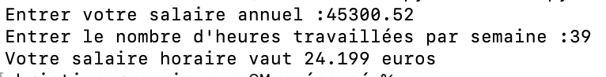

Petit programme en ligne de commande qui calcule un salaire horaire à partir d'un salaire annuel et d'un nombre d'heures travaillées par semaine.
Suivant le cours Apprenez les bases Python disponible sur OpenClassroom.

Fonctionnalités
- Saisie du salaire annuel et du nombre d'heures travaillées par semaine
- Prise en charge des nombres décimaux (par exemple 37.5 heures)

Ce que j'ai appris
- Définir et appeler des fonctions avec des paramètres et return
- Découper un problème en petites étapes réutilisables

Limites actuelles et pistes d'amélioration
- Approximation du calendrier : le programme considère qu'un mois fait exactement 4 semaines.
- Le programme ne précise pas s'il s'agit d'un salaire brut ou net

Autrice
@ChristianeLearningPython
